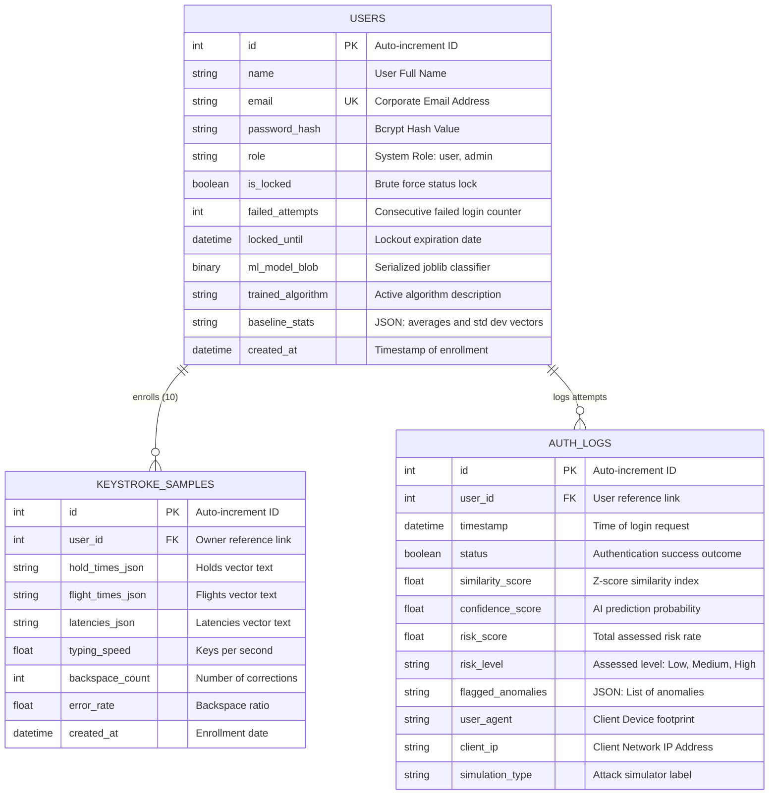
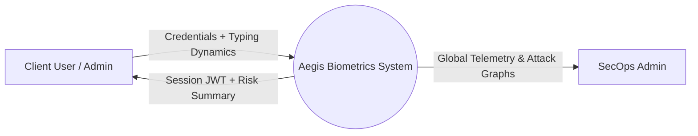
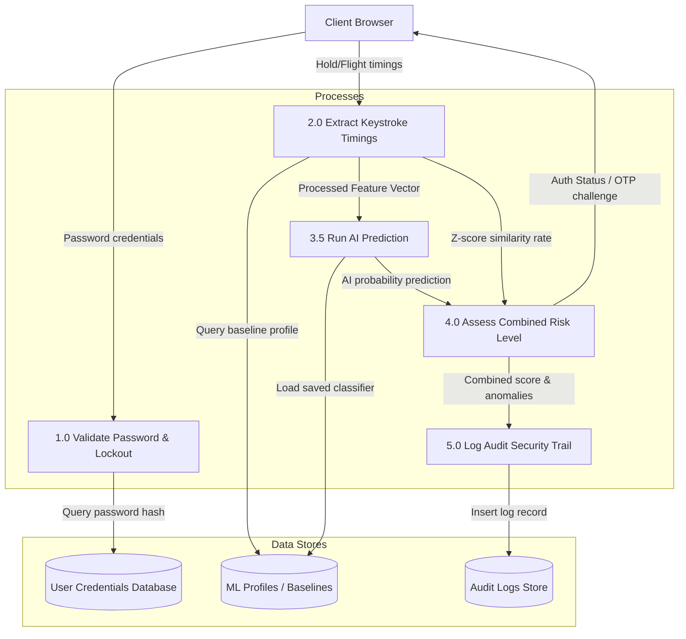
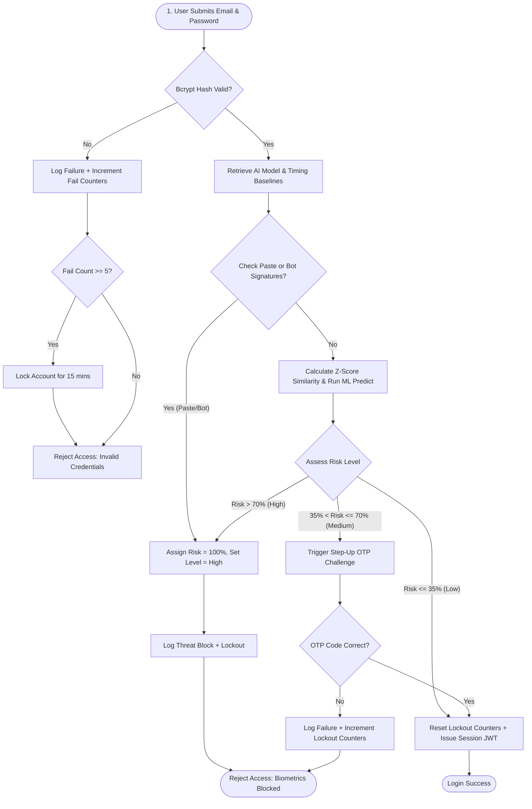
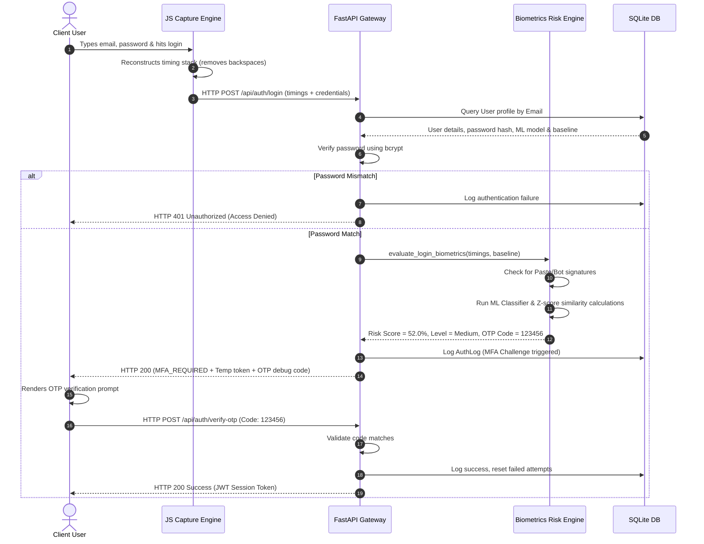

# Design & Architecture: AI-Powered Keystroke Dynamics Authentication System

This document outlines the architecture, database schemas, flowcharts, data flow diagrams (DFDs), use cases, sequence paths, and API documentation for the biometrics security system.

---

## 1. System Architecture Diagram

The application implements a decoupled, modern multi-tier architecture, utilizing a React Next.js frontend, a Python FastAPI REST API backend, and an SQLite database layer accessed through SQLAlchemy.

```mermaid
graph TD
    subgraph Frontend (React Next.js Layer)
        Client[Client Web Browser]
        Capture[JS Timing Capture Engine]
        DashUI[Admin / User Dashboard Visuals]
        Sim[Attack Simulator UI]
    end

    subgraph API Gateway / Middleware
        CORS[CORS Policy Handler]
        Rate[Rate Limiting Shield]
        SecureHeaders[Security Headers Middleware]
    end

    subgraph Backend Core (FastAPI Layer)
        API[FastAPI Controller Router]
        Auth[JWT & Bcrypt Credentials Auth]
        RiskEngine[Adaptive Biometric Risk Engine]
        ML[scikit-learn Analytics Classifier]
        Audit[Secure System Audit Logger]
    end

    subgraph Database Layer (SQLAlchemy ORM)
        DB[(SQLite File-based Database)]
    end

    Client -->|Types Keystrokes| Capture
    Capture -->|JSON Timings Payload| CORS
    CORS --> Rate
    Rate --> SecureHeaders
    SecureHeaders --> API
    API --> Auth
    API --> RiskEngine
    API --> ML
    API --> Audit
    
    Auth --> DB
    ML --> DB
    RiskEngine --> DB
    Audit --> DB
```

---

## 2. Entity-Relationship (ER) Diagram

The system stores user records, biometric timing samples, and access audit logs.



---

## 3. Data Flow Diagram (DFD)

### DFD Level 0 (System Context)



### DFD Level 1 (Process Breakdown)



---

## 4. System Flowchart (Biometric Authentication Loop)



---

## 5. Use Case Diagram

```mermaid
left_to_right_direction
actor User
actor Admin as "SecOps Admin"

rectangle Aegis_Authentication_System {
    User --> (Register Credentials & Type 10 Samples)
    User --> (Secure Biometric Login)
    User --> (Perform Adaptive OTP Step-Up)
    User --> (Inspect Typing Timeline & Speed Heatmap)
    User --> (Simulate Cyberattacks: Paste, Bot, Brute Force)
    
    (Secure Biometric Login) ..> (Evaluate Anomaly & Risk Score) : include
    
    Admin --> (Authenticate Admin Operations Session)
    Admin --> (View Global Real-time Security Log)
    Admin --> (Monitor ML Algorithm Accuracy Comparisons)
}
```

---

## 6. Sequence Diagram (Authentication and Adaptive MFA)



---

## 7. REST API Documentation

### 7.1. User Registration & Enrollment
* **Endpoint**: `POST /api/auth/register`
* **Request Body**:
```json
{
  "name": "John Doe",
  "email": "john@banking.com",
  "password": "SecurePassword123",
  "keystroke_samples": [
    {
      "hold_times": [112.5, 95.0, 120.0, 105.0],
      "flight_times": [140.0, 180.0, 160.0],
      "latencies": [252.5, 275.0, 280.0],
      "typing_speed": 4.8,
      "backspace_count": 0,
      "error_rate": 0.0
    }
    // ... requires exactly 10 timing objects
  ]
}
```
* **Response (HTTP 200)**:
```json
{
  "access_token": "eyJhbGciOiJIUzI1NiIsIn...",
  "token_type": "bearer",
  "role": "user",
  "user": {
    "id": 2,
    "name": "John Doe",
    "email": "john@banking.com",
    "role": "user",
    "created_at": "2026-07-01T20:00:00.000"
  }
}
```

### 7.2. Biometric Login Request
* **Endpoint**: `POST /api/auth/login`
* **Request Body**:
```json
{
  "email": "john@banking.com",
  "password": "SecurePassword123",
  "keystroke_data": {
    "hold_times": [110.0, 92.0, 122.0, 101.0],
    "flight_times": [145.0, 175.0, 165.0],
    "latencies": [255.0, 267.0, 287.0],
    "typing_speed": 4.9,
    "backspace_count": 0,
    "error_rate": 0.0
  },
  "simulation_type": "None"
}
```
* **Response (HTTP 200 - Access Accepted)**:
```json
{
  "access_token": "eyJhbGciOiJIUzI1NiIsIn...",
  "token_type": "bearer",
  "role": "user",
  "user": {
    "id": 2,
    "name": "John Doe",
    "email": "john@banking.com",
    "role": "user"
  }
}
```
* **Response (HTTP 200 - Step-Up MFA Challenge)**:
```json
{
  "status": "MFA_REQUIRED",
  "temp_token": "eyJhbGciOiJIUzI1NiIsIn...",
  "risk_score": 52.0,
  "anomalies": ["Moderate behavioral biometrics mismatch"],
  "otp_debug": "495810"
}
```

### 7.3. Verify Step-Up OTP
* **Endpoint**: `POST /api/auth/verify-otp`
* **Request Body**:
```json
{
  "email": "john@banking.com",
  "otp": "495810"
}
```
* **Response (HTTP 200)**: Same as Access Accepted JWT response.

### 7.4. User Dashboard Timeline Statistics
* **Endpoint**: `GET /api/dashboard/user-stats`
* **Headers**: `Authorization: Bearer <token>`
* **Response (HTTP 200)**:
```json
{
  "total_logins": 42,
  "failed_logins": 2,
  "avg_speed": 4.8,
  "avg_hold": 108.2,
  "avg_similarity": 89.4,
  "history": [
    {
      "id": 104,
      "timestamp": "2026-07-01T20:00:00Z",
      "status": true,
      "similarity_score": 92.5,
      "confidence_score": 96.0,
      "risk_score": 12.0,
      "risk_level": "Low",
      "flagged_anomalies": "[]",
      "simulation_type": "None"
    }
  ]
}
```

### 7.5. Admin Dashboard Global Telemetry
* **Endpoint**: `GET /api/dashboard/admin-stats`
* **Headers**: `Authorization: Bearer <token>`
* **Response (HTTP 200)**:
```json
{
  "total_users": 3,
  "total_attempts": 182,
  "failed_attempts": 32,
  "compromised_prevented": 14,
  "daily_logins": [
    { "date": "2026-06-30", "success": 12, "failed": 2 }
  ],
  "anomalies_distribution": [
    { "name": "Bot Signature", "value": 8 }
  ],
  "recent_attempts": []
}
```
