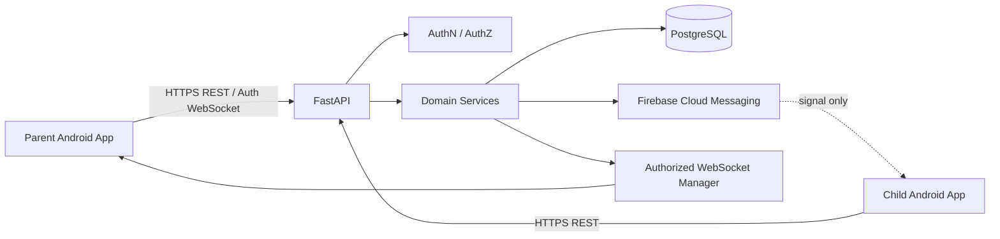

# ARCHITECTURE — Backend Server

## 1. Server responsibilities
The backend is the trusted authority for authentication verification, authorization, persistence, command state, safety-event processing, and notifications. Mobile apps are untrusted clients. PostgreSQL is the durable source of truth.

## 2. Proposed component flow


## 3. Suggested backend folder structure
```text
backend/
├── app/
│   ├── main.py
│   ├── core/
│   │   ├── config.py
│   │   ├── logging.py
│   │   └── security.py
│   ├── api/
│   │   └── v1/
│   │       ├── router.py
│   │       └── endpoints/
│   ├── db/
│   │   ├── base.py
│   │   └── session.py
│   ├── models/
│   ├── schemas/
│   ├── repositories/
│   ├── services/
│   ├── notifications/
│   ├── websocket/
│   └── workers/
├── alembic/
├── tests/
├── alembic.ini
├── pyproject.toml or requirements.txt
├── .env.example
├── .gitignore
└── README.md
```
Inspect the repository first. Adapt this layout if code already exists; do not overwrite or move files without a clear reason.

## 4. Domain modules
- **Config:** typed settings loaded from environment variables.
- **Auth:** verify tokens or integrate with the selected identity provider; derive identity from verified claims.
- **Pairing:** issue, hash, expire, claim, and revoke pairing secrets and guardian-child relationships.
- **Location:** validate and persist points; query latest/history; handle duplicate, stale, and out-of-order data.
- **Device status:** persist only necessary battery/connectivity/permission/sharing fields.
- **Commands:** durable safety-check command creation, pending command retrieval, expiry, response and acknowledgement.
- **Safety events:** SOS, safe-zone enter/exit, event listing and acknowledgement.
- **Notifications:** FCM integration, token management, retries and failure handling.
- **WebSockets:** authenticate, authorize subscriptions, publish scoped events, manage disconnects.
- **Retention/audit:** data deletion/retention jobs and privacy-safe audit events.
- **Health:** health/readiness checks without secret leakage.

## 5. Initial data model
Use UUID IDs where practical, UTC timestamps, foreign keys, constraints, and indexes. Final schema must be implemented through Alembic migrations.

- `users`: id, auth_subject or email/password identity fields (choose a single strategy), role, timestamps, disabled_at.
- `child_profiles`: id, user_id where applicable, display_name, sharing_enabled, timestamps, deleted_at.
- `guardian_child_links`: id, guardian_user_id, child_profile_id, status, created_at, revoked_at.
- `pairing_codes`: id, code_hash, creator, expiry, used_at, attempts, created_at.
- `location_points`: id, child_profile_id, latitude, longitude, accuracy_m, captured_at, received_at.
- `device_status`: id, child_profile_id, battery_percent, connectivity_state, permission_state, sharing_enabled, observed_at, received_at.
- `safe_zones`: id, child_profile_id, name, center latitude/longitude, radius_m, enabled, timestamps.
- `safety_events`: id, child_profile_id, event_type, severity, minimal details, created_at, acknowledged_at.
- `commands`: id, child_profile_id, guardian_user_id, command_type, minimal payload, status, created_at, expires_at, responded_at.
- `device_tokens`: id, user_id, protected FCM token, platform, timestamps, revoked_at.
- `audit_events`: id, actor, action, target, result, timestamp, request_id.

Do not store raw pairing secrets. Never put passwords, access tokens, service credentials, or unnecessary precise coordinates in logs.

## 6. Proposed API outline
Prefix: `/api/v1`. Exact request/response schemas must be documented in OpenAPI.

- `GET /health` — basic health check.
- `GET /api/v1/me` — authenticated profile.
- `POST /api/v1/pairing-codes` — issue a short-lived pairing invitation.
- `POST /api/v1/pairing/claim` — claim invitation.
- `GET /api/v1/children` — list children linked to current guardian.
- `DELETE /api/v1/children/{child_id}/link` — unlink after authorization.
- `POST /api/v1/children/{child_id}/locations` — child submits location.
- `GET /api/v1/children/{child_id}/location/latest` — authorized latest location.
- `GET /api/v1/children/{child_id}/locations` — paginated history.
- `POST /api/v1/children/{child_id}/status` — minimal device status.
- `GET/POST /api/v1/children/{child_id}/safe-zones` — list/create zones.
- `PATCH/DELETE /api/v1/safe-zones/{zone_id}` — update/disable/delete after authorization.
- `POST /api/v1/children/{child_id}/sos` — persist SOS.
- `GET /api/v1/children/{child_id}/events` — authorized event list.
- `POST /api/v1/children/{child_id}/commands` — create allowed guardian command.
- `GET /api/v1/child/commands/pending` — child's own pending commands.
- `POST /api/v1/commands/{command_id}/response` — respond to a command.
- `WS /api/v1/ws` — authenticated parent event stream.

These are proposals, not existing endpoints. Use consistent REST semantics and publish the actual contract in FastAPI OpenAPI docs.

## 7. Key flows
### Location upload
1. Child app checks that sharing is enabled and Android permission is granted.
2. App sends location and captured timestamp over HTTPS using authenticated identity.
3. API validates identity, coordinate ranges, timestamps, rate limits and child association.
4. API stores the point with server receipt time.
5. API evaluates safe-zone transitions and publishes permitted events.
6. Parent fetches latest/history or receives a scoped WebSocket update.

### Safety-check command
1. Guardian creates request.
2. API checks active link and allowed command type.
3. API commits the command to PostgreSQL.
4. API attempts an FCM signal.
5. Child app fetches pending commands from the API and displays the check.
6. Child responds; API persists the response and notifies authorized parent sessions.
7. FCM failure must not erase the command.

### SOS
1. Child explicitly submits SOS.
2. API validates the authenticated child identity and persists the event.
3. API attempts notification to linked guardians.
4. Parent sees the event via notification and/or WebSocket/API fetch.
5. The UI reports only what the server knows about submission and notification attempts.

## 8. Security design
- TLS for deployed API/database connections.
- Verify token signature, issuer, audience and expiry for the chosen auth system.
- Apply relationship-based authorization to every child-specific query and mutation.
- Rate-limit login/pairing and abuse-prone actions.
- Validate request sizes, coordinates, timestamps, enum values and safe-zone radii.
- Use least-privilege database credentials.
- Keep `.env`, credentials and real data out of Git.
- Minimize FCM payloads; fetch sensitive details through authenticated API.
- Authenticate WebSockets and authorize each subscription; never broadcast all events to all clients.
- Use transactions and idempotency where appropriate.
- Implement retention and deletion procedures.
- Avoid verbose production errors and sensitive logging.

## 9. Deployment
- Local setup uses `.env` and `.env.example` with placeholder values only.
- Render hosts the FastAPI service; Neon or equivalent hosts PostgreSQL.
- Configure database URL, auth settings, allowed origins if relevant, and FCM credentials in the hosting dashboard.
- Run Alembic migrations as a documented release step.
- Configure health checks, logs, and separate development/production resources.
- Document backup/recovery and migration rollback limitations.

## 10. Validation checklist
- [ ] API starts locally.
- [ ] Database migrations run on a clean database.
- [ ] No secrets in repository.
- [ ] Every child resource is authorization-scoped.
- [ ] Invalid/stale location is handled safely.
- [ ] FCM failure leaves persisted commands available.
- [ ] WebSocket reconnect can resynchronize via REST.
- [ ] Critical flows and negative authorization paths are tested.
